<div align="center">


# Meterly

**Usage metering and usage-based billing that is exact to the cent.**

Idempotent event ingestion, declarative billable metrics, typed pricing models, period close into immutable invoices, re-rating, real-time entitlements, and a finance console with a pricing simulator.

[](https://www.python.org/)
[](https://fastapi.tiangolo.com/)
[](https://docs.pydantic.dev/)
[](https://www.postgresql.org/)
[](https://redis.io/)
<br />
[](https://nextjs.org/)
[](https://www.typescriptlang.org/)
[](https://ui.shadcn.com/)
[](https://mypy-lang.org/)
[](https://hypothesis.readthedocs.io/)
[](.github/workflows/ci.yml)
[](LICENSE)

[Why](#why-this-exists) · [Features](#feature-highlights) · [Screenshots](#screenshots) · [Architecture](#architecture) · [Quickstart](#quickstart) · [API](#api-overview) · [Decisions](#engineering-decisions-and-trade-offs)

</div>

<br />

<picture>
  <source media="(prefers-color-scheme: dark)" srcset="docs/screenshots/overview-dark.png" />
  <source media="(prefers-color-scheme: light)" srcset="docs/screenshots/overview-light.png" />
  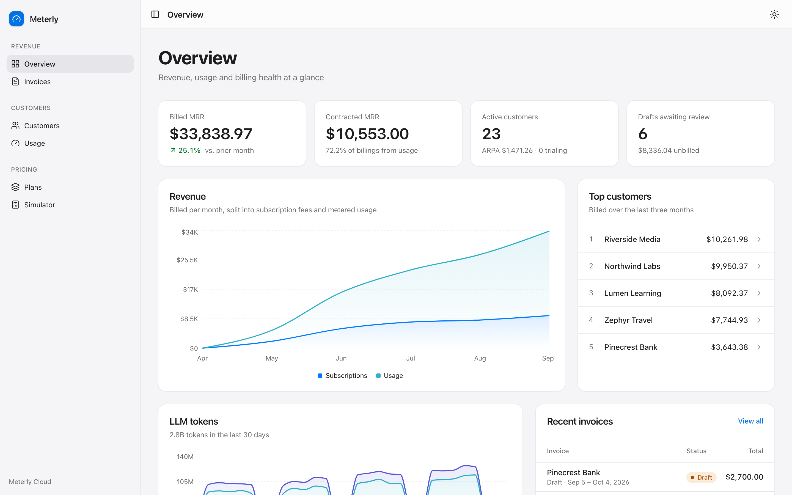
</picture>

<p align="center"><sub>The overview against seeded demo data: six months of an AI platform's usage, 24 customers and about 260k events. Switch GitHub to dark mode to see the dark theme.</sub></p>

---

## Why this exists

Usage-based pricing breaks easily. Events get retried. They arrive hours late. A customer upgrades on the 14th of a 31-day month. A $0.0000095-per-token rate meets 77 million tokens. Finance needs to try new pricing on last month's invoice before anything goes out. Every one of these is a place where cents go missing or a customer gets billed twice.

Meterly is a compact billing engine in the spirit of [Lago](https://github.com/getlago/lago), [OpenMeter](https://github.com/openmeterio/openmeter) and [Orb](https://www.withorb.com/). It takes those problems seriously:

- **Ingestion is idempotent.** It dedupes in the database, and it is safe under concurrent retries of the same batch.
- **Money is a value type.** Amounts are `Decimal` with a currency. Rounding is banker's rounding (half-even), applied **once per line**. Breakdowns are allocated so they always add back up to their line.
- **Invoices are frozen.** A usage snapshot is stored with each draft. Once an invoice is finalized, a Postgres trigger rejects any change to it.
- **Pricing is pure.** The engine is a pure function from `(PriceModel, quantity, currency)` to `Money`, and it is property-tested with Hypothesis.

## Feature highlights

| | |
|---|---|
| **Idempotent batch ingestion** | `POST /v1/events/batch` returns `202` with a status for each item (`accepted`, `duplicate` or `rejected`, plus `late` and per-metric warnings). Items are validated one at a time with Pydantic v2, so one bad event never sinks the batch. Dedupe on `(customer, transaction_id)` uses `INSERT … ON CONFLICT DO NOTHING RETURNING`. |
| **Declarative billable metrics** | `COUNT`, `SUM`, `MAX`, `UNIQUE_COUNT` and `LATEST` over a dot-path into event properties (`usage.total_tokens`), with up to three group-by dimensions. A metric created later is backfilled from the raw log under an advisory lock, so every event lands in its rollups exactly once. |
| **Hourly rollups plus an audit path** | `usage_rollups_hourly` and `usage_unique_values` are upserted in the same transaction as the raw insert. `GET /v1/metrics/{code}/reconcile` recomputes a window straight from the partitioned raw events and compares the two. |
| **Pricing as a discriminated union** | `flat`, `per_unit`, `package`, `volume` and `graduated` prices, plus free allowances, per-charge minimum spend and plan-level minimum commitments. Tier ordering is validated at parse time. The engine calculates at 60 digits of precision and rounds only at the end. |
| **Plans, versions, subscriptions** | Plan versions can't be changed once published. Subscriptions support billing anchors (the 31st clamps correctly), trials, cancellation, and mid-cycle upgrades and downgrades, prorated by day across phases. Postgres exclusion constraints stop phases or subscriptions from overlapping. |
| **Period close worker** | arq cron jobs claim due subscriptions with `FOR UPDATE SKIP LOCKED`. For each one, in a single transaction, the worker freezes the usage snapshot, prices it, writes the draft and its lines, and moves the billing cursor forward. A failure backs off exponentially without stalling the queue. Drafts finalize after a review window and get a sequential invoice number from a Postgres sequence. |
| **Invoice rendering** | The HTML invoice comes from a Jinja2 template. PDFs use WeasyPrint, falling back to fpdf2 on hosts without Pango. They render off the event loop and are stored apart from the immutable invoice row. |
| **Re-rating with a diff** | Apply candidate prices to a draft's frozen usage, preview the before/after change for every line, then apply. Finalized invoices refuse this. |
| **Real-time entitlements** | `GET /v1/customers/{id}/entitlements/{feature}` answers "is this allowed, and how much is left?" from the current period's rollups. Results are cached in Redis under a per-customer generation counter, so invalidation is a single `INCR` with no key scans. |
| **Finance console** | Next.js 15, strict TypeScript, shadcn/ui, Recharts and TanStack Query, with an Apple-inspired design in light and dark themes. Screens cover MRR, revenue mix, usage timelines, invoices with tier breakdowns, a re-rating panel and a pricing simulator. |

## Screenshots

**Finalized invoice.** A mid-cycle upgrade from Growth to Scale, prorated by day across both plans, with per-model breakdowns that add up to their line.

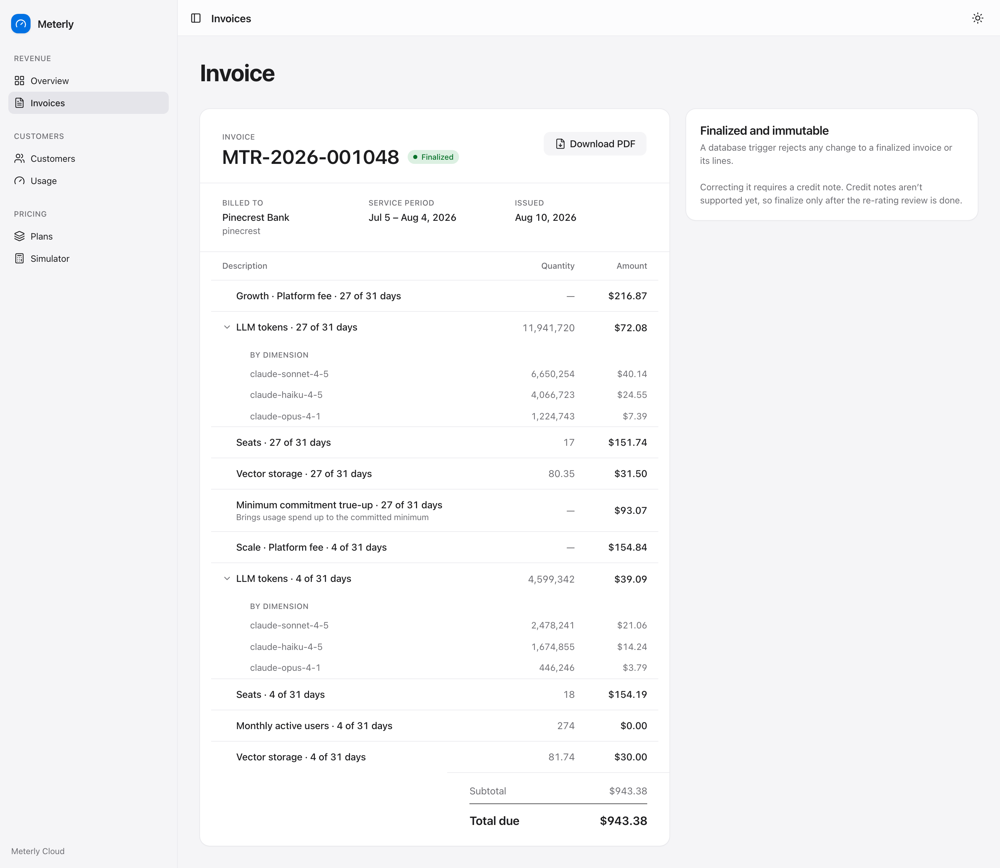

**Re-rating a draft.** Remove the free allowance, raise the first tier, and see the effect on each line before applying.

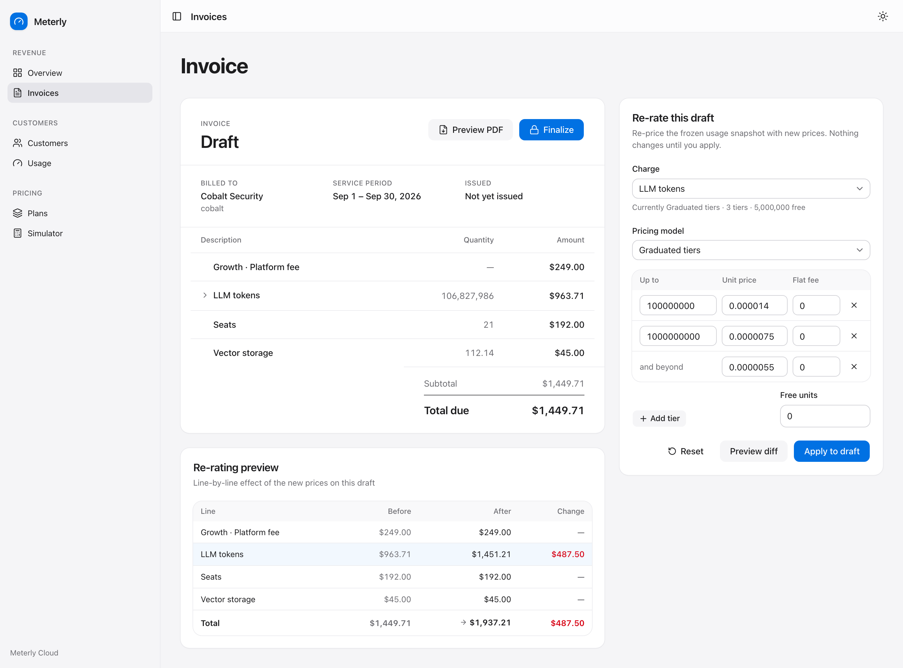

**Pricing simulator.** Replays six months of a Scale customer's metered usage through Growth v2, period by period.

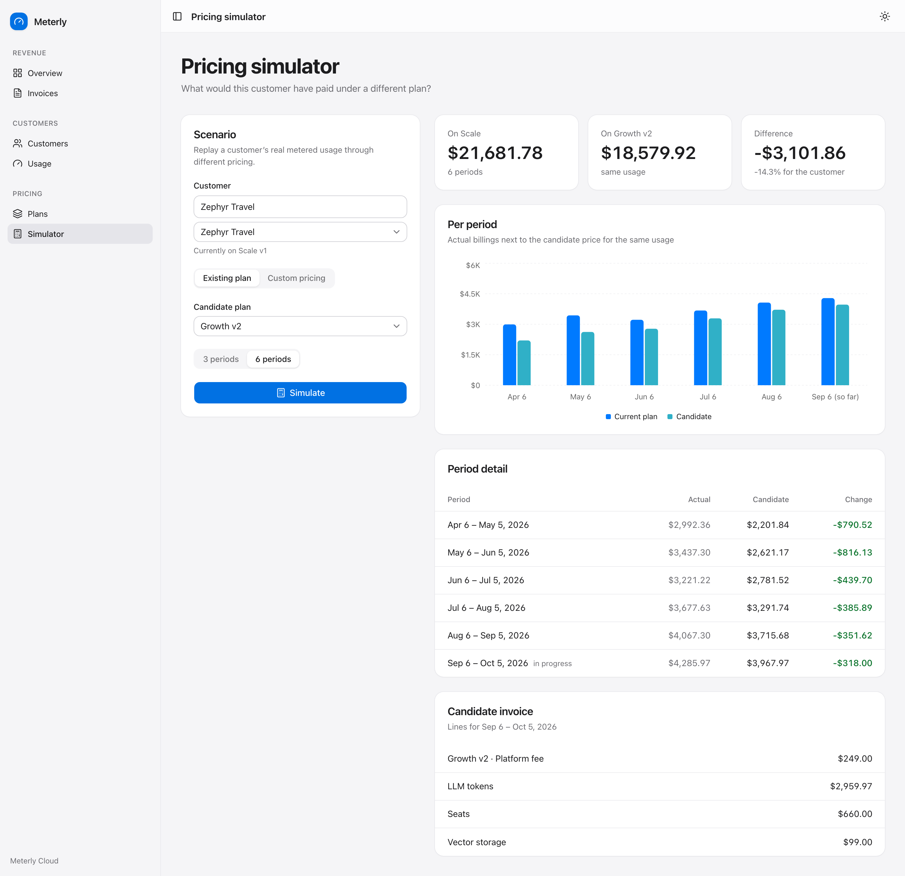

**Customer detail.** Usage timeline grouped by model, live entitlements, and the upcoming invoice accrued so far, prorated across a plan change.

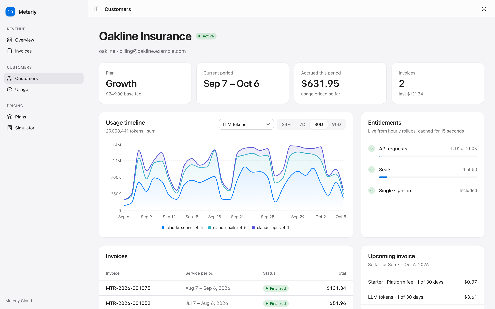

**Rendered invoice.** The Jinja2 template behind the PDF, served at `/v1/invoices/{id}/html`.

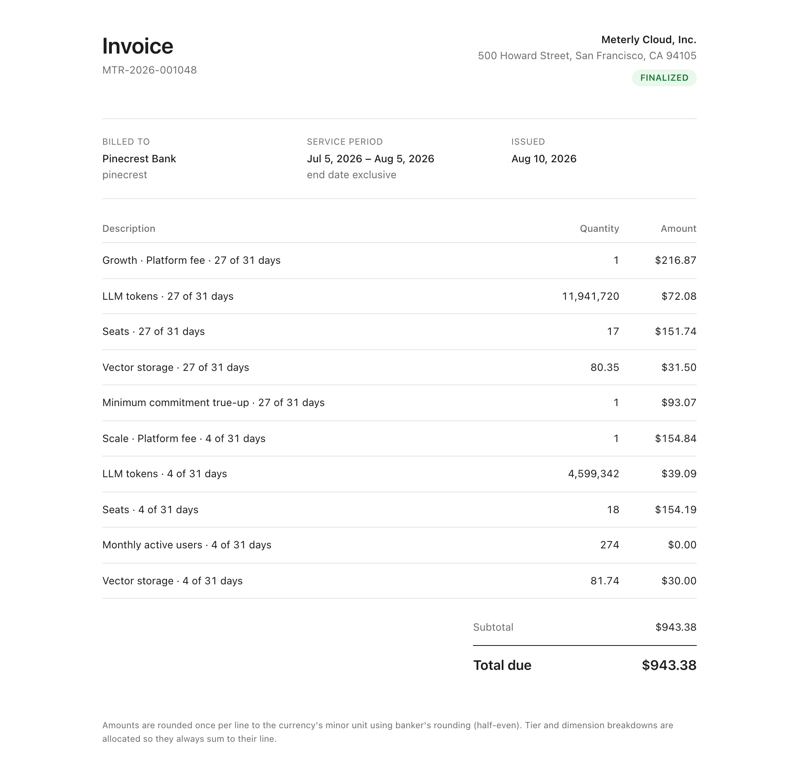

**Invoices.** Drafts stay open for review, then finalize with a sequential number.

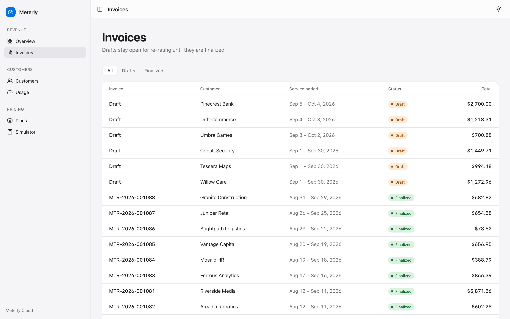

**Usage.** Declarative metrics and their aggregation, charted from hourly rollups.

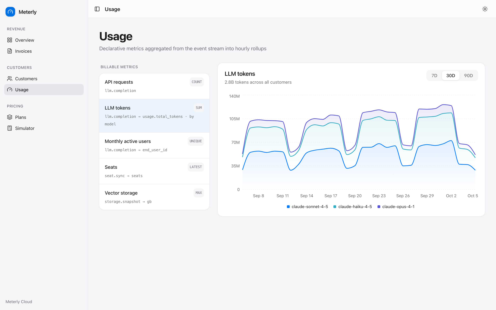

**Plans.** Versioned terms: graduated and volume tiers, packages, free units and minimums.

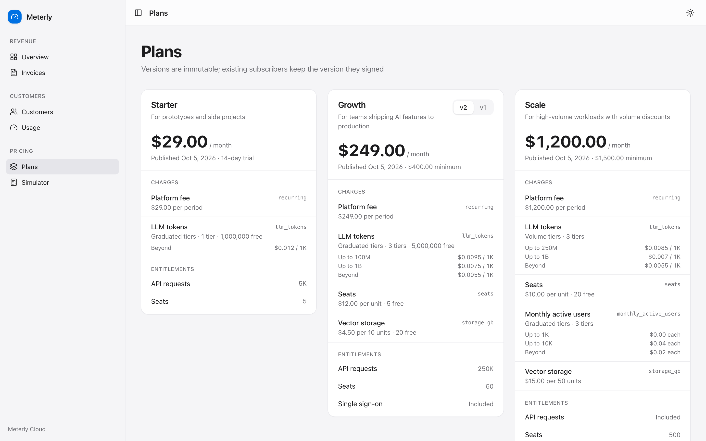

## Architecture

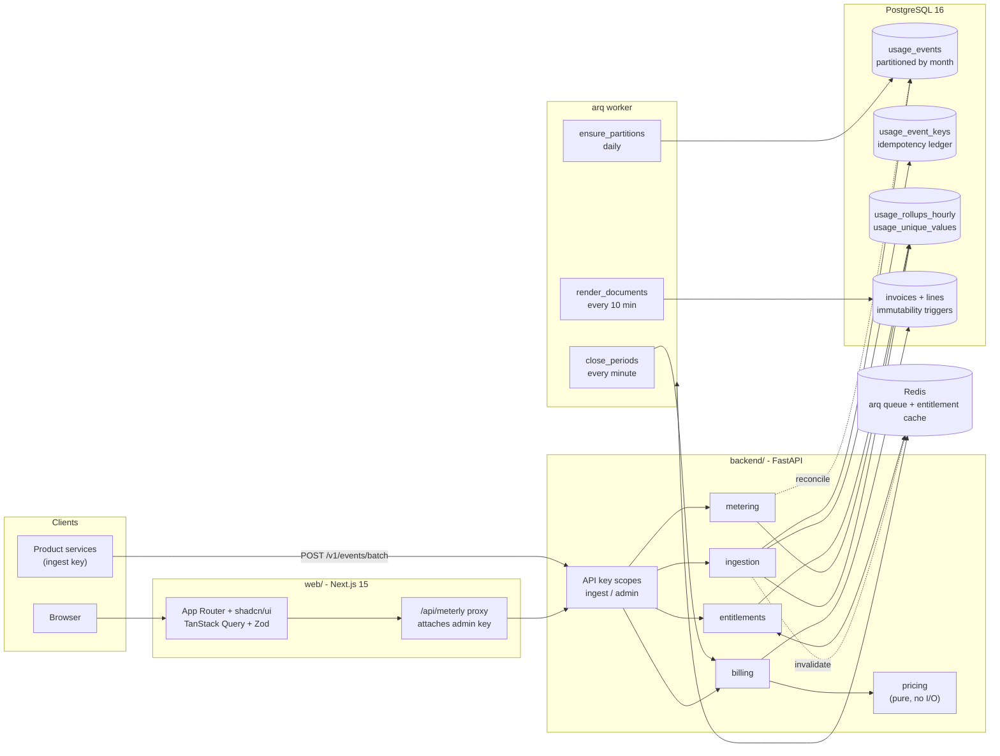

The backend is a single Python package (`meterly`) organized by domain. Dependencies point one way. `pricing` and `money` import nothing outside themselves, `billing` composes `metering` and `pricing`, and the HTTP layer (`api`) only wires services to routes. Every service takes an injectable `clock`, which is what lets the tests cover time-dependent behavior with `time-machine`.

### Core flow: ingesting a batch

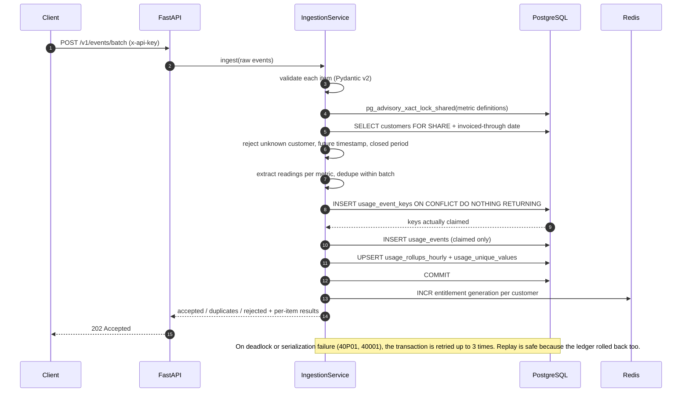

### Period close

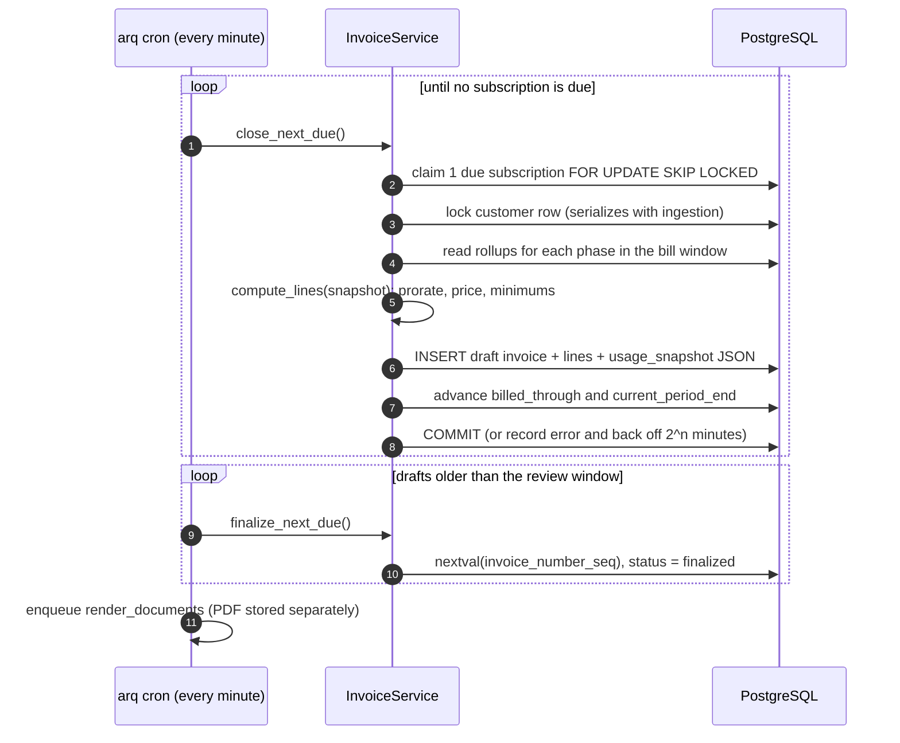

### User flow (console)

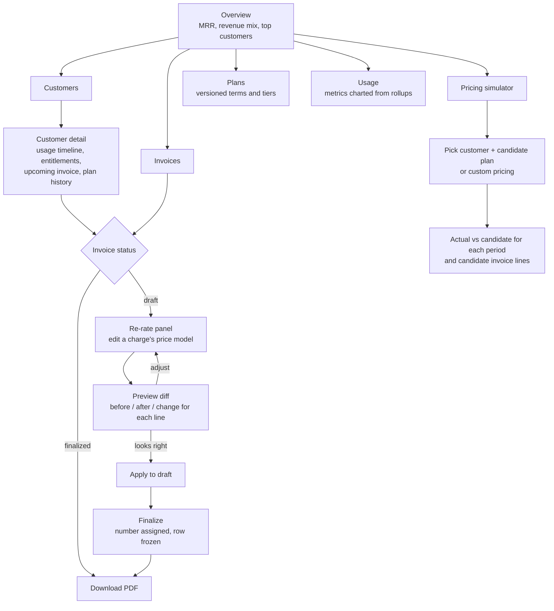

### Data model

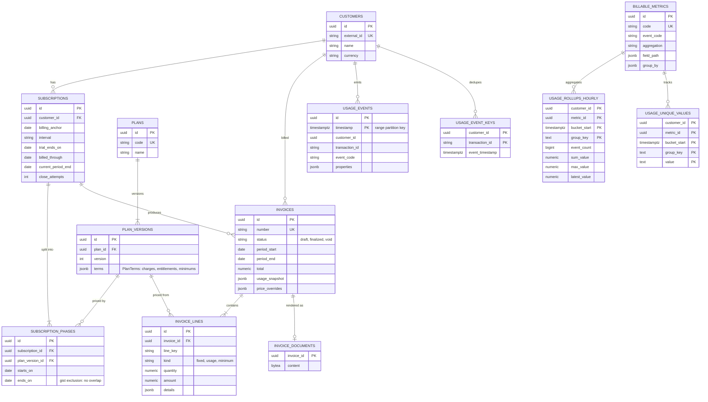

## Tech stack

| Layer | Choice | Why |
|---|---|---|
| API | **FastAPI** on Python 3.12 | Async I/O, OpenAPI docs at `/docs`, dependency injection for scoped auth |
| Validation | **Pydantic v2** + pydantic-settings | Discriminated unions for price models, `extra="forbid"` everywhere, typed settings |
| Persistence | **SQLAlchemy 2.0 async** + asyncpg, **Alembic** | Typed `Mapped[]` models, Postgres-specific upserts, one hand-reviewed migration |
| Database | **PostgreSQL 16** | Range partitioning, `ON CONFLICT`, gist exclusion constraints, PL/pgSQL triggers, advisory locks |
| Jobs | **arq** on Redis | Async cron for period close, PDF rendering and partition upkeep |
| Cache | **Redis** | Entitlement results with a short TTL and generation-based invalidation |
| Documents | **Jinja2** + **WeasyPrint** (fpdf2 fallback) | HTML invoice template, rendered to PDF |
| Quality | **mypy --strict**, **Ruff**, **pytest**, **Hypothesis**, **time-machine** | Strict types, property tests for money, frozen clocks for billing periods |
| Console | **Next.js 15** App Router, **TypeScript strict**, **shadcn/ui**, **Recharts**, **TanStack Query**, **Zod** | API responses parsed by Zod schemas that a contract test checks against the live API |
| Delivery | **Docker Compose**, **GitHub Actions** | Postgres 16 + Redis 7 + migrate + API + worker + web. CI runs backend, web and contract jobs. |

## Engineering decisions and trade-offs

<details open>
<summary><b>Idempotency lives in a ledger table, not on the partitioned events table</b></summary>

In Postgres, a unique index on a partitioned table must include the partition key. A `UNIQUE (customer_id, transaction_id)` on `usage_events` would therefore be impossible, or would only be unique within a single month. Meterly keeps a small unpartitioned `usage_event_keys` table with that primary key. Each batch claims its keys with `INSERT … ON CONFLICT DO NOTHING RETURNING`, and only the rows that come back are inserted into `usage_events` and folded into rollups, all in one transaction. Keys are inserted in a canonical order so overlapping concurrent batches wait on each other instead of deadlocking. A test fires identical batches in parallel and asserts they are counted once.
</details>

<details>
<summary><b>Rollups are maintained incrementally, in the same transaction</b></summary>

Each batch is folded in memory first, so every rollup row is upserted once per statement, in sorted key order. `SUM` and `COUNT` add, `MAX` uses `GREATEST`, and `LATEST` keeps the value with the newest `latest_at`. `UNIQUE_COUNT` can't be summed across hours, so distinct values are stored per hour bucket and counted across the window. Dashboards and entitlement checks never scan raw events. The raw log stays as the audit trail, and `/reconcile` proves the two agree. The trade-off is write amplification: one event updates one rollup row per metric that reads it.
</details>

<details>
<summary><b>Rounding happens once per line, and residue is allocated, never dropped</b></summary>

`Money` refuses an amount with more precision than its currency allows. Pricing runs in a 60-digit `Decimal` context, because a 30-digit quantity times a sub-cent unit price would round too early under the default 28 digits. Each invoice line is rounded once, half-even. The subtotal is the plain sum of those rounded lines. Tier and dimension breakdowns use largest-remainder allocation, so a line's parts always add up to the line. Hypothesis checks these properties over arbitrary tier lists, quantities and currencies (including zero-decimal JPY).
</details>

<details>
<summary><b>Invoices freeze their inputs</b></summary>

When a draft is created, it stores the complete `UsageSnapshot`: each phase's plan terms, its window, and the usage per metric and group. Re-rating and the line computation (`compute_lines`) are pure functions over that snapshot, so the same input always produces the same cents. The re-rate diff therefore never depends on events that arrived later. Finalization assigns a number from `invoice_number_seq`. After that, PL/pgSQL triggers reject any `UPDATE` or `DELETE` on the invoice and any change to its lines. The rendered PDF lives in `invoice_documents` so storing it never touches the frozen row.
</details>

<details>
<summary><b>Period close and late events are ordered explicitly</b></summary>

The worker waits `METERLY_CLOSE_GRACE_MINUTES` after a period ends before closing it. Ingestion takes a shared lock on the customer row, and period close takes a conflicting lock before it snapshots. A batch therefore either commits before the snapshot or sees the new invoice and rejects events for that period with `period_closed`. Events that arrive within the window are accepted and flagged `late: true`.
</details>

<details>
<summary><b>Proration by day, phases as first-class rows</b></summary>

A plan change splits a subscription into `subscription_phases`, and a gist exclusion constraint prevents them from overlapping. Within each phase, fixed fees, free allowances and minimums are scaled by `days in phase / days in period`, and usage is priced against the rollups for that phase's window only. Billing periods are always computed from the original anchor. An anchor on Jan 31 therefore goes to Feb 28, then back to Mar 31, instead of drifting.
</details>

<details>
<summary><b>The browser never holds an API key</b></summary>

The API has two scopes: `ingest` for product code (events and entitlement checks) and `admin` for everything else. Keys are compared in constant time over their SHA-256 digests. The console calls its own `/api/meterly/[...path]` route handler, which accepts only `v1` paths and attaches the admin key on the server. In production, settings validation refuses development keys and keys shorter than 24 characters.
</details>

## Project structure

```text
meterly-billing/
├── backend/
│   ├── src/meterly/
│   │   ├── api/            # app factory, scoped API-key auth, routes, error mapping
│   │   ├── ingestion/      # batch service, idempotent repository, rollup folding, backfill
│   │   ├── metering/       # metric definitions, rollup and raw-event aggregation, reconcile
│   │   ├── pricing/        # PriceModel union + pure pricing engine
│   │   ├── money/          # Money value type, half-even rounding, largest-remainder allocation
│   │   ├── billing/        # plans, subscriptions, periods, calculator, invoicing, re-rate, simulator, render
│   │   ├── entitlements/   # quota resolver + Redis generation cache
│   │   ├── analytics/      # MRR, revenue mix, top customers
│   │   ├── worker/         # arq cron jobs
│   │   ├── db/             # SQLAlchemy models and session
│   │   └── templates/      # invoice.html (Jinja2)
│   ├── alembic/            # schema, partition function, immutability triggers
│   ├── scripts/            # seed.py (six-month replay), loadgen.py
│   └── tests/              # unit (pricing, money, calculator, periods) + integration
├── web/
│   └── src/
│       ├── app/            # overview, invoices, customers, usage, plans, simulator, /api/meterly proxy
│       ├── components/     # feature views, charts, shell, shadcn/ui primitives
│       └── lib/            # Zod API schemas, typed client, query hooks, formatting
├── docs/screenshots/
├── docker-compose.yml
└── Makefile
```

## Quickstart

### Local

Prerequisites: Python 3.12+, Node 22+ with pnpm 9, a PostgreSQL 16 or 17 server binary (Homebrew's `postgresql@17` works), and `redis-server`.

```bash
make install     # backend venv (editable, with dev extras) + pnpm install
make db-up       # Postgres on :5507 and Redis on :6407, data under .data/
make seed        # migrations + six months of demo data (~65 s)
make api         # http://localhost:8107/docs
make worker      # period close, finalization, PDFs, partitions
make web         # console on http://localhost:3107
```

`make db-up` prefers Homebrew `postgresql@17` or `@16`. If it can't find a working server, point it at one with `make db-up PG_BIN=/path/to/postgres/bin`. Stop everything with `make db-down`.

The seed replays its timeline day by day through the real services. Every demo invoice was produced by the same period-close path the worker runs.

### Docker Compose

```bash
docker compose up --build                                  # postgres, redis, migrate, api, worker, web
docker compose run --rm api python scripts/seed.py         # optional demo data
```

The console is on http://localhost:3107 and the API on http://localhost:8107/docs. The backend image installs WeasyPrint's native dependencies, so PDFs render with WeasyPrint there.

### Try it

```bash
# Ingest two events; the second is a duplicate of the first
curl -s localhost:8107/v1/events/batch \
  -H 'x-api-key: mtr_ingest_dev_only' -H 'content-type: application/json' \
  -d '{"events":[
    {"transaction_id":"tx_1","customer_id":"northwind","code":"llm.completion",
     "timestamp":"2026-10-04T12:00:00Z",
     "properties":{"model":"claude-sonnet-4-5","end_user_id":"u_1","usage":{"total_tokens":1200}}},
    {"transaction_id":"tx_1","customer_id":"northwind","code":"llm.completion",
     "timestamp":"2026-10-04T12:00:00Z","properties":{}}]}'

# Is this customer still within quota?
curl -s localhost:8107/v1/customers/northwind/entitlements/seats -H 'x-api-key: mtr_ingest_dev_only'

# Price a quantity with any model, no persistence
curl -s localhost:8107/v1/pricing/quote -H 'x-api-key: mtr_admin_dev_only' -H 'content-type: application/json' \
  -d '{"price":{"model":"graduated","tiers":[{"up_to":"1000","unit_price":"0.10"},{"up_to":null,"unit_price":"0.05"}]},"quantity":"1500"}'
```

## Configuration

Backend settings use the `METERLY_` prefix and are read from the environment or `backend/.env` (see `backend/.env.example`).

| Variable | Default | Purpose |
|---|---|---|
| `METERLY_ENV` | `development` | `production` enforces real API keys |
| `METERLY_DATABASE_URL` | `postgresql+asyncpg://meterly@localhost:5507/meterly` | Postgres DSN |
| `METERLY_DATABASE_POOL_SIZE` | `10` | SQLAlchemy pool size |
| `METERLY_REDIS_URL` | `redis://localhost:6407/0` | arq queue and entitlement cache |
| `METERLY_ADMIN_API_KEY` | `mtr_admin_dev_only` | Full access: console, plans, invoices, billing runs |
| `METERLY_INGEST_API_KEY` | `mtr_ingest_dev_only` | Event ingestion and entitlement checks only |
| `METERLY_CORS_ORIGINS` | `["http://localhost:3107"]` | Allowed browser origins |
| `METERLY_MAX_BATCH_SIZE` | `1000` | Events per batch request |
| `METERLY_MAX_FUTURE_SKEW_SECONDS` | `300` | Reject events this far ahead of the server clock |
| `METERLY_LATE_EVENT_THRESHOLD_MINUTES` | `60` | Older events are accepted but flagged `late` |
| `METERLY_CLOSE_GRACE_MINUTES` | `60` | Wait after a period ends before closing it |
| `METERLY_DRAFT_REVIEW_HOURS` | `72` | How long drafts stay open for re-rating before auto-finalize |
| `METERLY_ENTITLEMENT_CACHE_TTL_SECONDS` | `15` | Entitlement cache TTL |
| `METERLY_INVOICE_NUMBER_PREFIX` | `MTR` | Invoice numbers look like `MTR-2026-001083` |
| `METERLY_SELLER_NAME` / `METERLY_SELLER_ADDRESS` | demo values | Printed on invoices |
| `METERLY_LOG_LEVEL` / `METERLY_LOG_JSON` | `INFO` / `false` | structlog output |

Console (`web/.env.example`), server-side only:

| Variable | Default | Purpose |
|---|---|---|
| `METERLY_API_URL` | `http://localhost:8107` | Where the `/api/meterly` proxy forwards |
| `METERLY_ADMIN_API_KEY` | dev key in `pnpm dev`; **required** for `pnpm start` | Attached by the proxy and never sent to the browser |

## Testing

```bash
make test        # pytest (unit + integration) and vitest
make typecheck   # mypy --strict and tsc --noEmit
make lint        # ruff + eslint + prettier
make ci          # all of the above plus the production build
```

- **Property-based tests (Hypothesis).** These check that graduated tiers cover the whole quantity and add up to the total in every currency (including zero-decimal JPY). Pricing must never decrease as quantity grows. Volume, graduated and per-unit pricing must agree on a single tier. `allocate` must never lose a cent. Prorated invoices with a mid-period plan change must always add up to their subtotal, and a billing period must always contain the day it was computed for.
- **Time-dependent logic (time-machine).** Integration tests freeze the clock to cover the full close, re-rate and finalize cycle, trials with minimum commitments, mid-cycle upgrades, scheduled plan changes, and event partition boundaries. Unit tests pin anchor clamping (Jan 31 to Feb 28, then back to Mar 31).
- **Concurrency and correctness.** Tests cover identical batches sent concurrently, replayed batches, a missing property that skips only the metric that needs it, rollups that must match raw events for every aggregation, one failing subscription that must not stall the close cycle, and the database triggers that block edits to finalized invoices.
- **Contract test.** The console's Zod schemas parse live API responses, which catches drift between the two. It runs in CI against a seeded API, or locally with `METERLY_CONTRACT_API_URL=http://localhost:8107 pnpm test` in `web/`.

The backend suite runs against a real Postgres (`meterly_test` on :5507). It currently passes 66 tests in about 10 seconds.

### Load generator

```bash
make loadgen     # 50,000 events, batches of 500, 8 concurrent clients, 2% duplicates
```

Sample run on a laptop (Apple Silicon, a single uvicorn process, local Postgres):

```text
events     50,000 in 8.7s  (5,716 events/s)
batches    100 x 500, concurrency 8
latency    p50 645 ms   p95 996 ms   max 1869 ms
results    accepted 48,995  duplicates 1,005  rejected 0  http errors 0
```

## API overview

Interactive docs are at `http://localhost:8107/docs`. Every `/v1` route needs an `x-api-key` header.

| Method | Path | Scope | Purpose |
|---|---|---|---|
| `POST` | `/v1/events/batch` | ingest | Ingest up to 1,000 events; returns per-item status (`202`) |
| `GET` | `/v1/events` | admin | Recent events, cursor-paginated |
| `GET` | `/v1/customers/{id}/entitlements` | ingest | Every feature of the current plan with quota left |
| `GET` | `/v1/customers/{id}/entitlements/{feature}` | ingest | Single entitlement check (cached) |
| `GET` `POST` | `/v1/customers` | admin | List or create customers |
| `GET` | `/v1/customers/{id}` · `/usage` · `/invoices` | admin | Customer detail, usage series, invoices |
| `GET` `POST` | `/v1/metrics` | admin | List or create billable metrics (with backfill) |
| `GET` | `/v1/metrics/{code}/usage` | admin | Time series from rollups, optionally grouped |
| `GET` | `/v1/metrics/{code}/reconcile` | admin | Rollups vs raw events for a window |
| `GET` `POST` | `/v1/plans` · `/v1/plans/{code}` · `/v1/plans/{code}/versions` | admin | Plans and immutable versions |
| `POST` | `/v1/subscriptions` | admin | Subscribe with anchor and trial |
| `GET` | `/v1/subscriptions/{id}/upcoming-invoice` | admin | Current period priced so far |
| `POST` | `/v1/subscriptions/{id}/change-plan` | admin | Mid-cycle change with proration preview (`dry_run`) |
| `POST` | `/v1/subscriptions/{id}/cancel` | admin | Cancel on a date |
| `GET` | `/v1/invoices` · `/v1/invoices/{id}` | admin | List and detail |
| `GET` | `/v1/invoices/{id}/html` · `/pdf` | admin | Rendered invoice |
| `POST` | `/v1/invoices/{id}/rerate` | admin | Before/after diff; `apply: true` writes it to the draft |
| `POST` | `/v1/invoices/{id}/finalize` | admin | Number, freeze, render PDF |
| `POST` | `/v1/billing/run` | admin | Run one close cycle now |
| `POST` | `/v1/pricing/quote` | admin | Price a quantity with any model (pure) |
| `POST` | `/v1/simulations` | admin | Replay real usage through a candidate plan or custom terms |
| `GET` | `/v1/analytics/overview` · `/revenue` | admin | KPIs and monthly revenue mix |
| `GET` | `/healthz` · `/readyz` | none | Liveness and readiness |

## Roadmap

- [ ] Credit notes and voiding, to correct finalized invoices without breaking immutability
- [ ] Prepaid credits and wallets drawn down by usage
- [ ] Tax line items through a pluggable tax provider
- [ ] Payment provider integration (Stripe PaymentIntents) and dunning
- [ ] Webhooks for `invoice.finalized` and `entitlement.exhausted`
- [ ] Multi-tenant isolation with per-tenant keys
- [ ] Spill rollups for very old buckets into a columnar store

## License

[MIT](LICENSE)
